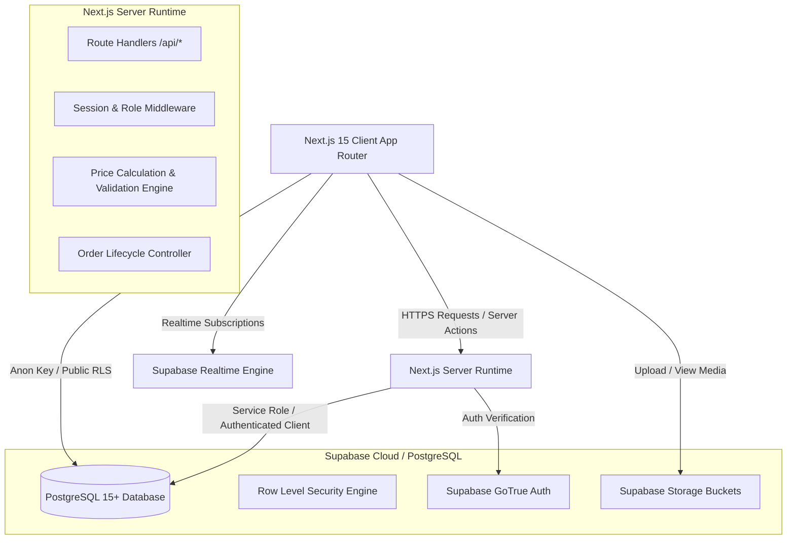
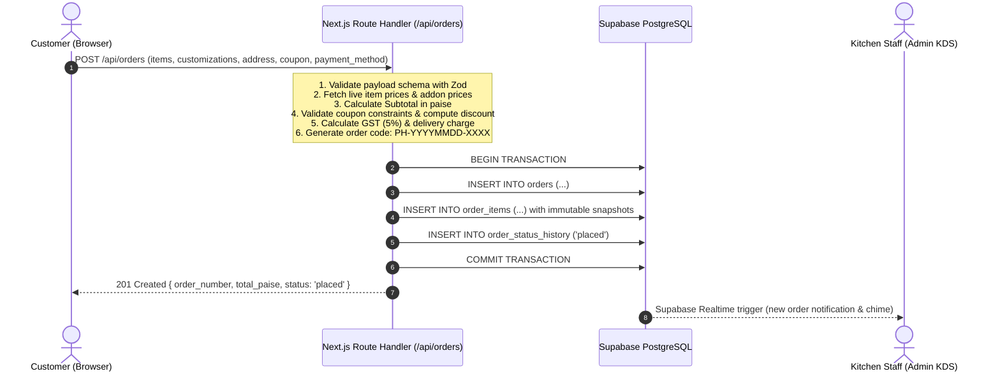

# Pizza Harrison - System Architecture Specification

## 1. System Overview

Pizza Harrison's digital platform is built as an enterprise-grade full-stack web application using modern, reactive, and server-first principles.



---

## 2. Technology Stack & Rationale

| Layer | Technology | Decision Rationale |
| :--- | :--- | :--- |
| **Framework** | **Next.js 15 (App Router)** | Hybrid SSR, SSG, and Server Actions. Provides optimal SEO for Mathura search queries, fast edge delivery, and secure server-only route execution. |
| **Language** | **TypeScript 5+** | End-to-end type safety across database entities, API payloads, cart items, and component props. Eliminates runtime shape mismatches. |
| **Styling** | **Tailwind CSS + Custom Design System** | High-performance atomic utility CSS. Bespoke palette reflecting artisan pizza craftsmanship (warm terracotta, deep charcoal, mozzarella cream, basil green). |
| **Components** | **Radix UI Primitives / shadcn inspired** | WAI-ARIA compliant accessible modals, dropdowns, tabs, dialogs, and toast notifications. |
| **Icons** | **Lucide React** | Clean, lightweight, consistent vector iconography. |
| **Animations** | **Framer Motion / Motion** | Fluid micro-interactions for cart drawer, category pills, order tracking timeline, and modal open states. |
| **Database** | **Supabase PostgreSQL** | Relational integrity, ACID transactions for billing, triggers, foreign keys, and Row Level Security (RLS). |
| **Realtime** | **Supabase Realtime (WebSockets)** | Instant synchronization for Kitchen Display System when orders change status without aggressive polling. |
| **Storage** | **Supabase Storage** | CDN-backed image hosting for menu items and banners. |
| **Deployment** | **Vercel** | Global edge network, automatic CI/CD preview deployments, zero-config Next.js optimization. |

---

## 3. Client vs Server Boundary & Security Architecture

### 3.1 Architectural Rules

1. **Zero Privileged Keys in Browser**:
   - `NEXT_PUBLIC_SUPABASE_URL` and `NEXT_PUBLIC_SUPABASE_ANON_KEY` are safe for public consumption and respect Row Level Security policies.
   - `SUPABASE_SERVICE_ROLE_KEY` is strictly confined to server-side code (`process.env.SUPABASE_SERVICE_ROLE_KEY`), used only for trusted business operations (e.g. system audit logs, verifying and writing immutable order invoices).
2. **Server-Authoritative Pricing**:
   - The browser never submits an authorative `total_price` or `discount_price`.
   - The client submits item IDs, variant IDs, crust IDs, add-on IDs, quantities, and an optional coupon code.
   - The server queries live prices from the database, computes subtotal in integer paise, applies discounts, taxes (GST 5%), delivery fees, and validates business constraints before writing to the database.
3. **Protected Admin Routes**:
   - Route middleware (`middleware.ts`) and server-side layout guards check JWT session claims and verify user role (`admin`, `manager`, `staff`) against the `profiles` table.
   - Unauthenticated or unauthorized visitors attempting to access `/admin/*` are redirected to `/admin/login`.

---

## 4. Application Directory Structure

```text
pizza-harrison/
├── docs/                             # Architectural source of truth
│   ├── PRODUCT_SPEC.md
│   ├── ARCHITECTURE.md
│   ├── DATABASE_SCHEMA.md
│   ├── ROUTES_AND_PERMISSIONS.md
│   ├── BUSINESS_RULES.md
│   ├── TEST_PLAN.md
│   └── DEPLOYMENT.md
├── src/
│   ├── app/                          # Next.js App Router
│   │   ├── (storefront)/             # Public Customer App
│   │   │   ├── page.tsx              # Home / Hero / Features / Specials
│   │   │   ├── menu/                 # Interactive Menu & Customizer
│   │   │   ├── offers/               # Coupons & Student Combos
│   │   │   ├── cart/                 # Cart & Checkout
│   │   │   ├── order-tracking/[code]/# Live Order Tracker
│   │   │   ├── book-table/           # Table Reservation Request
│   │   │   ├── about/                # Story & Outlets
│   │   │   ├── contact/              # Branch info & Google Map
│   │   │   ├── reviews/              # Verified Customer Reviews
│   │   │   └── layout.tsx
│   │   ├── admin/                    # Operations Dashboard
│   │   │   ├── login/                # Staff Sign-in
│   │   │   ├── page.tsx              # Analytics & Overview Dashboard
│   │   │   ├── orders/               # Kitchen Display & Orders Pipeline
│   │   │   ├── bookings/             # Table Reservation Management
│   │   │   ├── menu/                 # Product Catalog & Price Management
│   │   │   ├── coupons/              # Promotion & Coupon Engine
│   │   │   ├── reviews/              # Review Moderation
│   │   │   ├── settings/             # Store Hours & Delivery Charges
│   │   │   ├── audit-logs/           # System Audit Logs
│   │   │   └── layout.tsx
│   │   ├── api/                      # Server-side Route Handlers
│   │   │   ├── orders/               # Create / Query Orders
│   │   │   ├── coupons/validate/     # Server-side Coupon Engine
│   │   │   ├── bookings/             # Table Reservation API
│   │   │   ├── reviews/              # Reviews Submission API
│   │   │   └── admin/                # Gated Admin Endpoints
│   │   ├── layout.tsx                # Root layout
│   │   └── globals.css               # Global tokens, fonts, styles
│   ├── components/                   # Modular UI Components
│   │   ├── storefront/               # Navbar, Hero, PizzaCard, CartDrawer, etc.
│   │   ├── admin/                    # AdminSidebar, OrderCard, KDSBoard, etc.
│   │   └── ui/                       # Reusable primitives (Button, Modal, Input, Badge)
│   ├── lib/                          # Core Utilities & Infrastructure
│   │   ├── supabase/                 # Supabase client, server, and admin factories
│   │   ├── pricing/                  # Exact paise calculations & discount formulas
│   │   ├── types/                    # Unified TypeScript domain definitions
│   │   ├── validation/               # Zod schemas for order & booking validation
│   │   └── constants/                # Restaurant metadata, branch addresses, hours
│   └── store/                        # Client state (e.g., persistent cart store)
├── supabase/
│   ├── migrations/                   # Sequential SQL migration files
│   └── seed.sql                      # Initial authentic menu data for Mathura branches
├── public/                           # Static assets & brand imagery
├── package.json
├── tailwind.config.ts
└── tsconfig.json
```

---

## 5. Data Flow & Transaction Life Cycle

### 5.1 Order Submission Life Cycle



---

## 6. Resilience & Graceful Fallback Strategy

To ensure seamless local development, testing, and continuous operation even when remote external services (such as Supabase cloud or payment gateways) are pending configuration:
1. **Database Fallback Mode**: The application includes a self-contained in-memory / local storage data provider pre-seeded with authentic Pizza Harrison Mathura dishes, combos, and branch settings.
2. **Payment Mode**: Clear differentiation between production payment gateways (e.g. Razorpay) and genuine direct methods (Cash on Delivery, Pay at Counter, Verified UPI QR). Unavailable integrations clearly surface configuration status rather than faking success.
3. **Deterministic Error Handling**: All API routes return standard RFC-7807 compliant JSON error structures (`{ error: string, code: string, details?: any }`) with correct HTTP status codes.
