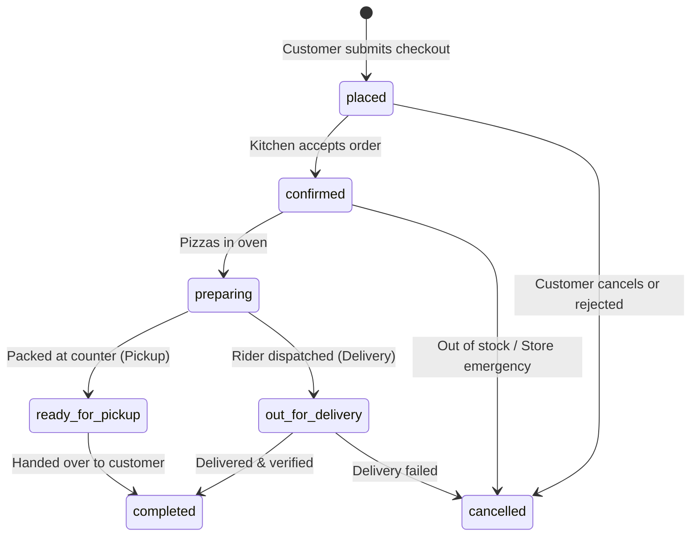

# Pizza Harrison - Business Rules & Financial Logic

## 1. Currency & Timezone Standards

1. **Official Currency**: Indian Rupee (`INR` / `₹`).
2. **Integer Storage Standard**: All monetary values are strictly processed and persisted as **integer paise** (1 Rupee = 100 paise).
   - Example: ₹299 = `29900` paise.
   - Example: ₹14.50 = `1450` paise.
   - **Prohibition**: Floating-point operations (`0.1 + 0.2`) must never be used for financial arithmetic.
3. **Official Timezone**: `Asia/Kolkata` (Indian Standard Time, UTC+05:30).
   - Order timestamps, delivery estimations, table reservation slots, and business hours must all evaluate within IST.

---

## 2. Server-Authoritative Price Calculation Engine

The server must calculate and verify all pricing before writing orders. The browser client's submitted totals are treated as unverified suggestions.

### 2.1 Formula Definitions

$$\text{Item Unit Price} = \text{Variant Price} + \text{Crust Price} + \sum (\text{Add-on Prices})$$
$$\text{Item Total} = \text{Item Unit Price} \times \text{Quantity}$$
$$\text{Cart Subtotal} = \sum (\text{Item Totals})$$

### 2.2 Coupon Discount Calculation

Given a coupon with $\text{min\_order\_paise}$, $\text{discount\_type}$, $\text{discount\_value}$, and $\text{max\_discount\_paise}$:

1. **Eligibility Check**:
   $$\text{Cart Subtotal} \ge \text{min\_order\_paise}$$
   If not satisfied, reject coupon with descriptive error (e.g., "Add items worth ₹120 more to use GLA100").
2. **Calculation**:
   - If $\text{discount\_type} == \text{'flat'}$:
     $$\text{Raw Discount} = \text{discount\_value}$$
   - If $\text{discount\_type} == \text{'percentage'}$:
     $$\text{Raw Discount} = \left\lfloor \frac{\text{Cart Subtotal} \times \text{discount\_value}}{100} \right\rfloor$$
3. **Cap Application**:
   - If $\text{max\_discount\_paise}$ is set:
     $$\text{Discount} = \min(\text{Raw Discount}, \text{max\_discount\_paise})$$
   - Otherwise:
     $$\text{Discount} = \text{Raw Discount}$$
   - And ensure:
     $$\text{Discount} = \min(\text{Discount}, \text{Cart Subtotal})$$

### 2.3 Delivery Fee Calculation

- If $\text{Order Type} == \text{'pickup'}$ or $\text{'dine\_in'}$:
  $$\text{Delivery Fee} = 0$$
- If $\text{Order Type} == \text{'delivery'}$:
  - If $\text{Cart Subtotal} \ge \text{Free Delivery Threshold (e.g. ₹499 / 49900 paise)}$:
    $$\text{Delivery Fee} = 0$$
  - Else:
    $$\text{Delivery Fee} = \text{Base Delivery Fee (e.g. ₹40 / 4000 paise)}$$

### 2.4 Restaurant GST (Taxes)

In accordance with Indian GST regulations for food establishments (standard 5% GST without input tax credit for restaurants):
$$\text{Taxable Subtotal} = \max(0, \text{Cart Subtotal} - \text{Discount})$$
$$\text{Tax (GST 5\%)} = \left\lfloor \frac{\text{Taxable Subtotal} \times 5}{100} \right\rfloor$$

### 2.5 Packaging Fee

- For delivery orders: Nominal eco-friendly pizza box fee (e.g. ₹15 / 1500 paise per order).
- For pickup: ₹0.

### 2.6 Grand Total

$$\text{Grand Total} = \text{Taxable Subtotal} + \text{Delivery Fee} + \text{Packaging Fee} + \text{Tax}$$

---

## 3. Order Lifecycle & Status Progression

Orders must transition only through permitted legal sequences:

### Transition Invariants
1. Once an order reaches `completed` or `cancelled`, it is terminal and cannot transition to any other status.
2. Orders in `preparing` status cannot be cancelled by the customer without administrative supervisor override.
3. Every status transition appends a permanent record to `order_status_history` capturing `old_status`, `new_status`, timestamp, and user identifier.

---

## 4. Table Reservation Business Rules

1. **Request Only**: A submitted booking is always initialized with status `requested`. It never claims guaranteed seating until confirmed by staff.
2. **Advance Notice**: Table reservations must be submitted at least 2 hours prior to the requested time slot, up to 14 days in advance.
3. **Capacity Constraints**: Maximum online group size is capped at 30 guests. Larger groups require direct managerial phone coordination.
4. **Valid Status Flow**:
   $$\text{requested} \longrightarrow \text{confirmed} \longrightarrow \text{seated} \longrightarrow \text{completed}$$
   $$\text{requested} \longrightarrow \text{rejected} \quad \text{or} \quad \text{confirmed} \longrightarrow \text{cancelled}$$

---

## 5. Genuine Payment & WhatsApp Handoff Rules

1. **No Pretend Payments**:
   - Marking an order as `payment_status = 'completed'` requires verified receipt.
   - For **Cash on Delivery**, payment remains `pending` until physical cash or UPI at delivery is collected and marked by staff.
   - For **UPI QR Code**, the customer submits their 12-digit UTR / transaction ID; staff verifies receipt in the bank app before closing the order.
   - If an online payment gateway (e.g. Razorpay) is not configured with live credentials, the UI must explicitly indicate that online gateway checkout is disabled or pending configuration, and safely offer Cash on Delivery or Pay at Counter instead.
2. **WhatsApp Notification Protocol**:
   - The customer may click "Share on WhatsApp" to send a copy of the order summary to the restaurant or friends.
   - **Rule**: A WhatsApp message or web link click **NEVER** constitutes proof of order acceptance. All official orders exist exclusively in the database.

---

## 6. Audit & Data Integrity Rules

1. **Price Freeze**: Changing a product's price in `/admin/menu` updates future orders only. Historical records in `order_items` retain their original paise values forever.
2. **Staff Auditing**: Any action that alters pricing, deletes items, overrides orders, or issues discretionary discounts must write an entry to `audit_logs`.
3. **No Self-Privilege Escalation**: Anonymous or customer users cannot modify their own profile role column under any circumstances.
