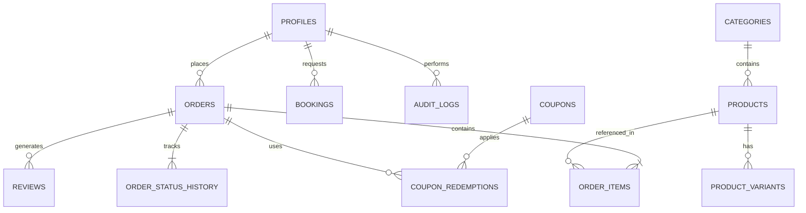

# Pizza Harrison - Database Schema Specification

## 1. Schema Design Philosophy

The database schema is modeled in PostgreSQL for high integrity, relational rigor, and exact financial calculations:
- **Exact Monetary Representation**: All monetary values (`price`, `subtotal`, `discount`, `tax`, `delivery_fee`, `total`) are stored as **64-bit integer paise** (`BIGINT`). Zero floating-point arithmetic. (e.g. ₹299.00 is stored as `29900`).
- **Immutable Financial Snapshots**: When an order is placed, the product name, variant name, crust name, addon items, and individual unit prices are frozen in `order_items`. Subsequent menu price alterations never corrupt past sales receipts or historical analytics.
- **Relational Integrity**: Strict foreign keys with `ON DELETE RESTRICT` or `ON DELETE CASCADE` where appropriate, preventing orphaned records.
- **Auditability**: Every critical entity includes `created_at` and `updated_at` timestamps with automatic trigger updates. Critical admin mutations write to `audit_logs`.
- **Row Level Security (RLS)**: Public anonymous clients can read active menu items and submit orders/bookings, but cannot modify catalog items, view unapproved reviews, or access administrative records.

---

## 2. Entity Relationship Diagram (ERD)



---

## 3. Relational Tables Specification

### 3.1 `profiles`
Represents staff and registered customer identities linked to `auth.users`.
```sql
CREATE TYPE user_role AS ENUM ('customer', 'staff', 'manager', 'admin');

CREATE TABLE profiles (
    id UUID PRIMARY KEY REFERENCES auth.users(id) ON DELETE CASCADE,
    full_name TEXT NOT NULL,
    phone VARCHAR(15),
    role user_role NOT NULL DEFAULT 'customer',
    created_at TIMESTAMPTZ NOT NULL DEFAULT NOW(),
    updated_at TIMESTAMPTZ NOT NULL DEFAULT NOW()
);

CREATE INDEX idx_profiles_role ON profiles(role);
CREATE INDEX idx_profiles_phone ON profiles(phone);
```

### 3.2 `categories`
Organizes menu sections (e.g. Classic Pizzas, Cheese Burst Specials, Garlic Breads).
```sql
CREATE TABLE categories (
    id UUID PRIMARY KEY DEFAULT gen_random_uuid(),
    name TEXT NOT NULL,
    slug TEXT NOT NULL UNIQUE,
    description TEXT,
    image_url TEXT,
    sort_order INT NOT NULL DEFAULT 0,
    is_active BOOLEAN NOT NULL DEFAULT true,
    created_at TIMESTAMPTZ NOT NULL DEFAULT NOW(),
    updated_at TIMESTAMPTZ NOT NULL DEFAULT NOW()
);

CREATE INDEX idx_categories_active_order ON categories(is_active, sort_order);
```

### 3.3 `products`
Individual menu items offered at Pizza Harrison Mathura.
```sql
CREATE TABLE products (
    id UUID PRIMARY KEY DEFAULT gen_random_uuid(),
    category_id UUID NOT NULL REFERENCES categories(id) ON DELETE RESTRICT,
    name TEXT NOT NULL,
    slug TEXT NOT NULL UNIQUE,
    description TEXT NOT NULL,
    image_url TEXT,
    is_veg BOOLEAN NOT NULL DEFAULT true,
    is_spicy BOOLEAN NOT NULL DEFAULT false,
    is_bestseller BOOLEAN NOT NULL DEFAULT false,
    is_available BOOLEAN NOT NULL DEFAULT true,
    base_price_paise BIGINT NOT NULL CHECK (base_price_paise >= 0),
    sort_order INT NOT NULL DEFAULT 0,
    created_at TIMESTAMPTZ NOT NULL DEFAULT NOW(),
    updated_at TIMESTAMPTZ NOT NULL DEFAULT NOW()
);

CREATE INDEX idx_products_category ON products(category_id);
CREATE INDEX idx_products_available ON products(is_available);
```

### 3.4 `product_variants`
Size-specific options (Regular 7", Medium 9", Large 12") and their specific prices.
```sql
CREATE TABLE product_variants (
    id UUID PRIMARY KEY DEFAULT gen_random_uuid(),
    product_id UUID NOT NULL REFERENCES products(id) ON DELETE CASCADE,
    size_name TEXT NOT NULL, -- 'Regular 7"', 'Medium 9"', 'Large 12"'
    price_paise BIGINT NOT NULL CHECK (price_paise >= 0),
    is_default BOOLEAN NOT NULL DEFAULT false,
    is_available BOOLEAN NOT NULL DEFAULT true,
    created_at TIMESTAMPTZ NOT NULL DEFAULT NOW(),
    CONSTRAINT unique_product_size UNIQUE (product_id, size_name)
);

CREATE INDEX idx_product_variants_product ON product_variants(product_id);
```

### 3.5 `crust_options`
Crust types available for pizzas.
```sql
CREATE TABLE crust_options (
    id UUID PRIMARY KEY DEFAULT gen_random_uuid(),
    name TEXT NOT NULL UNIQUE, -- 'New Hand Tossed', 'Cheese Burst', 'Fresh Pan', 'Thin Crust'
    description TEXT,
    price_paise BIGINT NOT NULL DEFAULT 0 CHECK (price_paise >= 0),
    is_default BOOLEAN NOT NULL DEFAULT false,
    is_available BOOLEAN NOT NULL DEFAULT true,
    created_at TIMESTAMPTZ NOT NULL DEFAULT NOW()
);
```

### 3.6 `addons`
Extra toppings and dips.
```sql
CREATE TYPE addon_category AS ENUM ('extra_cheese', 'veg_toppings', 'sauces', 'dips');

CREATE TABLE addons (
    id UUID PRIMARY KEY DEFAULT gen_random_uuid(),
    name TEXT NOT NULL UNIQUE, -- 'Extra Mozzarella', 'Fresh Paneer', 'Crisp Capsicum', 'Sweet Corn'
    category addon_category NOT NULL,
    price_paise BIGINT NOT NULL CHECK (price_paise >= 0),
    is_available BOOLEAN NOT NULL DEFAULT true,
    created_at TIMESTAMPTZ NOT NULL DEFAULT NOW()
);

CREATE INDEX idx_addons_category ON addons(category);
```

### 3.7 `orders`
Primary order records for both delivery and takeaway.
```sql
CREATE TYPE order_type_enum AS ENUM ('delivery', 'pickup', 'dine_in');
CREATE TYPE order_status_enum AS ENUM ('placed', 'confirmed', 'preparing', 'out_for_delivery', 'ready_for_pickup', 'completed', 'cancelled');
CREATE TYPE payment_method_enum AS ENUM ('cod', 'pay_at_counter', 'upi_qr', 'online');
CREATE TYPE payment_status_enum AS ENUM ('pending', 'completed', 'failed');
CREATE TYPE branch_enum AS ENUM ('pali_khera', 'gla_university');

CREATE TABLE orders (
    id UUID PRIMARY KEY DEFAULT gen_random_uuid(),
    order_number VARCHAR(32) NOT NULL UNIQUE, -- e.g. 'PH-20261014-4821'
    customer_id UUID REFERENCES profiles(id) ON DELETE SET NULL,
    customer_name TEXT NOT NULL,
    customer_phone VARCHAR(15) NOT NULL,
    customer_email TEXT,
    order_type order_type_enum NOT NULL DEFAULT 'delivery',
    branch branch_enum NOT NULL DEFAULT 'pali_khera',
    delivery_address TEXT,
    delivery_landmark TEXT,
    delivery_instructions TEXT,
    status order_status_enum NOT NULL DEFAULT 'placed',
    payment_method payment_method_enum NOT NULL DEFAULT 'cod',
    payment_status payment_status_enum NOT NULL DEFAULT 'pending',
    subtotal_paise BIGINT NOT NULL CHECK (subtotal_paise >= 0),
    discount_paise BIGINT NOT NULL DEFAULT 0 CHECK (discount_paise >= 0),
    delivery_fee_paise BIGINT NOT NULL DEFAULT 0 CHECK (delivery_fee_paise >= 0),
    tax_paise BIGINT NOT NULL DEFAULT 0 CHECK (tax_paise >= 0),
    packaging_fee_paise BIGINT NOT NULL DEFAULT 0 CHECK (packaging_fee_paise >= 0),
    total_paise BIGINT NOT NULL CHECK (total_paise >= 0),
    applied_coupon_code VARCHAR(32),
    notes TEXT,
    cancellation_reason TEXT,
    created_at TIMESTAMPTZ NOT NULL DEFAULT NOW(),
    updated_at TIMESTAMPTZ NOT NULL DEFAULT NOW()
);

CREATE INDEX idx_orders_status ON orders(status);
CREATE INDEX idx_orders_created_at ON orders(created_at DESC);
CREATE INDEX idx_orders_customer_phone ON orders(customer_phone);
CREATE INDEX idx_orders_branch ON orders(branch);
```

### 3.8 `order_items`
Immutable item-by-item snapshot of every product in an order.
```sql
CREATE TABLE order_items (
    id UUID PRIMARY KEY DEFAULT gen_random_uuid(),
    order_id UUID NOT NULL REFERENCES orders(id) ON DELETE CASCADE,
    product_id UUID REFERENCES products(id) ON DELETE SET NULL,
    product_name TEXT NOT NULL,
    variant_name TEXT, -- e.g. 'Medium 9"'
    crust_name TEXT, -- e.g. 'Cheese Burst'
    unit_price_paise BIGINT NOT NULL CHECK (unit_price_paise >= 0),
    quantity INT NOT NULL CHECK (quantity > 0),
    addons_json JSONB DEFAULT '[]'::JSONB, -- Array of { name: string, price_paise: number }
    item_total_paise BIGINT NOT NULL CHECK (item_total_paise >= 0),
    created_at TIMESTAMPTZ NOT NULL DEFAULT NOW()
);

CREATE INDEX idx_order_items_order ON order_items(order_id);
```

### 3.9 `order_status_history`
Chronological state audit for order status transitions.
```sql
CREATE TABLE order_status_history (
    id UUID PRIMARY KEY DEFAULT gen_random_uuid(),
    order_id UUID NOT NULL REFERENCES orders(id) ON DELETE CASCADE,
    old_status order_status_enum,
    new_status order_status_enum NOT NULL,
    changed_by UUID REFERENCES profiles(id) ON DELETE SET NULL,
    notes TEXT,
    created_at TIMESTAMPTZ NOT NULL DEFAULT NOW()
);

CREATE INDEX idx_order_status_history_order ON order_status_history(order_id);
```

### 3.10 `bookings`
Table reservation requests for Pali Khera and GLA University branches.
```sql
CREATE TYPE booking_status_enum AS ENUM ('requested', 'confirmed', 'rejected', 'seated', 'cancelled');

CREATE TABLE bookings (
    id UUID PRIMARY KEY DEFAULT gen_random_uuid(),
    booking_reference VARCHAR(32) NOT NULL UNIQUE, -- e.g. 'TB-20261014-912'
    customer_name TEXT NOT NULL,
    customer_phone VARCHAR(15) NOT NULL,
    customer_email TEXT,
    branch branch_enum NOT NULL DEFAULT 'pali_khera',
    guest_count INT NOT NULL CHECK (guest_count >= 1 AND guest_count <= 50),
    booking_date DATE NOT NULL,
    booking_time TIME NOT NULL,
    seating_preference TEXT DEFAULT 'indoor_ac',
    special_requests TEXT,
    status booking_status_enum NOT NULL DEFAULT 'requested',
    staff_notes TEXT,
    created_at TIMESTAMPTZ NOT NULL DEFAULT NOW(),
    updated_at TIMESTAMPTZ NOT NULL DEFAULT NOW()
);

CREATE INDEX idx_bookings_date ON bookings(booking_date, booking_time);
CREATE INDEX idx_bookings_status ON bookings(status);
```

### 3.11 `coupons` and `coupon_redemptions`
Discount promo engine with fraud controls.
```sql
CREATE TYPE discount_type_enum AS ENUM ('percentage', 'flat');

CREATE TABLE coupons (
    id UUID PRIMARY KEY DEFAULT gen_random_uuid(),
    code VARCHAR(32) NOT NULL UNIQUE,
    description TEXT NOT NULL,
    discount_type discount_type_enum NOT NULL,
    discount_value INT NOT NULL CHECK (discount_value > 0), -- e.g. 20 for 20%, or 10000 for ₹100
    min_order_paise BIGINT NOT NULL DEFAULT 0 CHECK (min_order_paise >= 0),
    max_discount_paise BIGINT CHECK (max_discount_paise IS NULL OR max_discount_paise > 0),
    max_uses INT DEFAULT NULL CHECK (max_uses IS NULL OR max_uses > 0),
    current_uses INT NOT NULL DEFAULT 0 CHECK (current_uses >= 0),
    is_active BOOLEAN NOT NULL DEFAULT true,
    valid_from TIMESTAMPTZ NOT NULL DEFAULT NOW(),
    valid_until TIMESTAMPTZ,
    created_at TIMESTAMPTZ NOT NULL DEFAULT NOW(),
    updated_at TIMESTAMPTZ NOT NULL DEFAULT NOW()
);

CREATE TABLE coupon_redemptions (
    id UUID PRIMARY KEY DEFAULT gen_random_uuid(),
    coupon_id UUID NOT NULL REFERENCES coupons(id) ON DELETE CASCADE,
    order_id UUID NOT NULL REFERENCES orders(id) ON DELETE CASCADE,
    customer_phone VARCHAR(15) NOT NULL,
    discount_applied_paise BIGINT NOT NULL CHECK (discount_applied_paise >= 0),
    redeemed_at TIMESTAMPTZ NOT NULL DEFAULT NOW()
);

CREATE INDEX idx_coupon_redemptions_phone ON coupon_redemptions(coupon_id, customer_phone);
```

### 3.12 `restaurant_settings`
Branch operational config, delivery thresholds, and contact information.
```sql
CREATE TABLE restaurant_settings (
    id UUID PRIMARY KEY DEFAULT gen_random_uuid(),
    key TEXT NOT NULL UNIQUE,
    value_json JSONB NOT NULL,
    updated_by UUID REFERENCES profiles(id) ON DELETE SET NULL,
    updated_at TIMESTAMPTZ NOT NULL DEFAULT NOW()
);
```

### 3.13 `reviews`
Customer reviews with staff moderation.
```sql
CREATE TABLE reviews (
    id UUID PRIMARY KEY DEFAULT gen_random_uuid(),
    customer_name TEXT NOT NULL,
    rating INT NOT NULL CHECK (rating >= 1 AND rating <= 5),
    comment TEXT NOT NULL,
    branch branch_enum NOT NULL DEFAULT 'pali_khera',
    is_approved BOOLEAN NOT NULL DEFAULT false,
    order_id UUID REFERENCES orders(id) ON DELETE SET NULL,
    created_at TIMESTAMPTZ NOT NULL DEFAULT NOW()
);

CREATE INDEX idx_reviews_approved ON reviews(is_approved, created_at DESC);
```

### 3.14 `audit_logs`
Immutable operational trail for compliance.
```sql
CREATE TABLE audit_logs (
    id UUID PRIMARY KEY DEFAULT gen_random_uuid(),
    user_id UUID REFERENCES profiles(id) ON DELETE SET NULL,
    action TEXT NOT NULL,
    entity_type TEXT NOT NULL,
    entity_id TEXT,
    old_state_json JSONB,
    new_state_json JSONB,
    ip_address TEXT,
    created_at TIMESTAMPTZ NOT NULL DEFAULT NOW()
);

CREATE INDEX idx_audit_logs_created ON audit_logs(created_at DESC);
```

---

## 4. Row Level Security (RLS) Policies

All tables have RLS enabled: `ALTER TABLE <table> ENABLE ROW LEVEL SECURITY;`.

1. **`categories`, `products`, `product_variants`, `crust_options`, `addons`**:
   - `SELECT`: Allowed for `anon` and `authenticated` where `is_active = true` or `is_available = true`.
   - `ALL`: Allowed only for authenticated users with role `admin` or `manager`.
2. **`orders`**:
   - `INSERT`: Allowed for `anon` and `authenticated` (new checkout submission).
   - `SELECT`: Allowed for order owner (`auth.uid() = customer_id`) OR via server-side verification using `order_number` and `customer_phone`.
   - `UPDATE` / `DELETE`: Staff, Manager, or Admin roles only.
3. **`order_items`**:
   - `SELECT`: Linked order's authorized viewer.
   - `INSERT`: Handled during server order transaction.
4. **`bookings`**:
   - `INSERT`: Allowed for public request submission.
   - `SELECT` / `UPDATE`: Staff, Manager, or Admin roles only.
5. **`reviews`**:
   - `SELECT`: Allowed for public where `is_approved = true`.
   - `INSERT`: Allowed for public.
   - `UPDATE` (moderation): Admin and Manager only.
6. **`audit_logs`, `restaurant_settings`**:
   - Admin and Manager access only.
